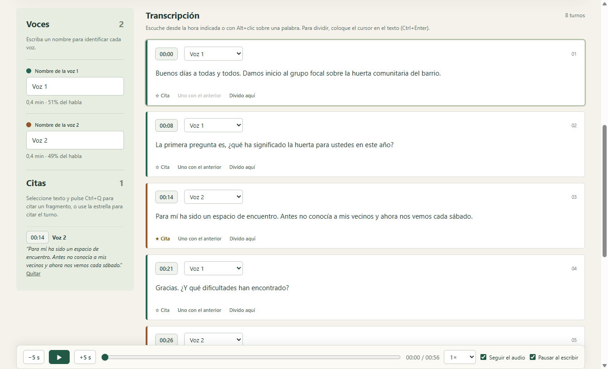
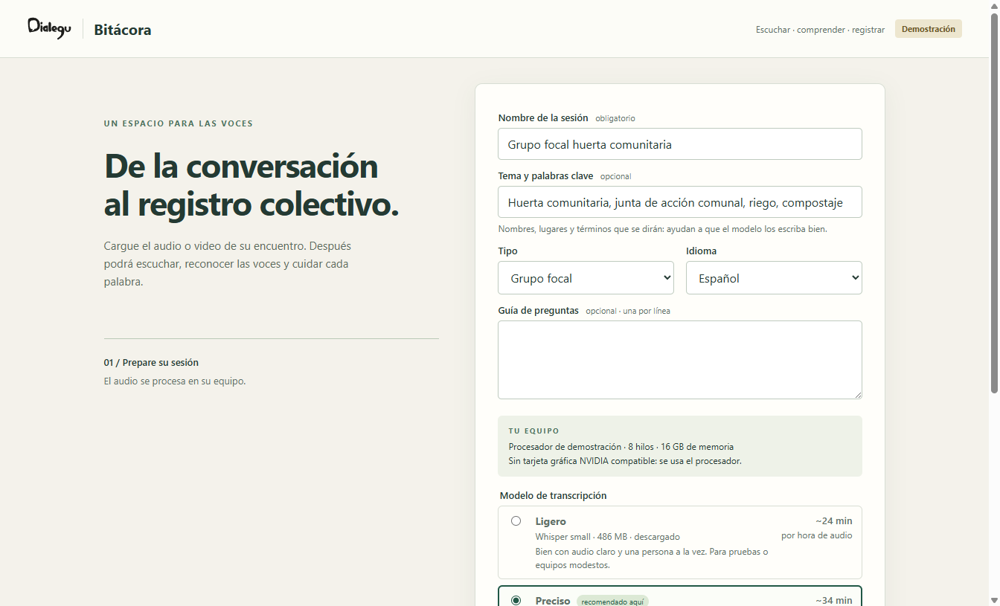
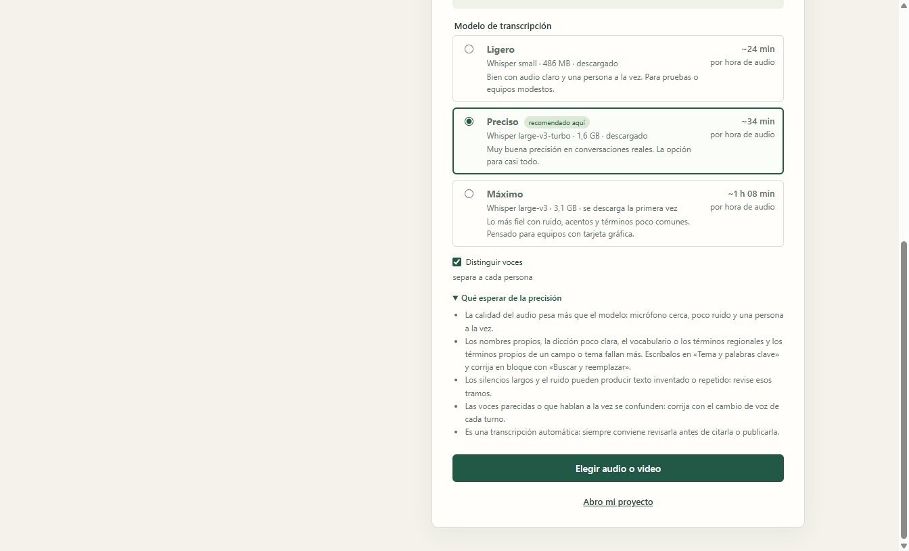
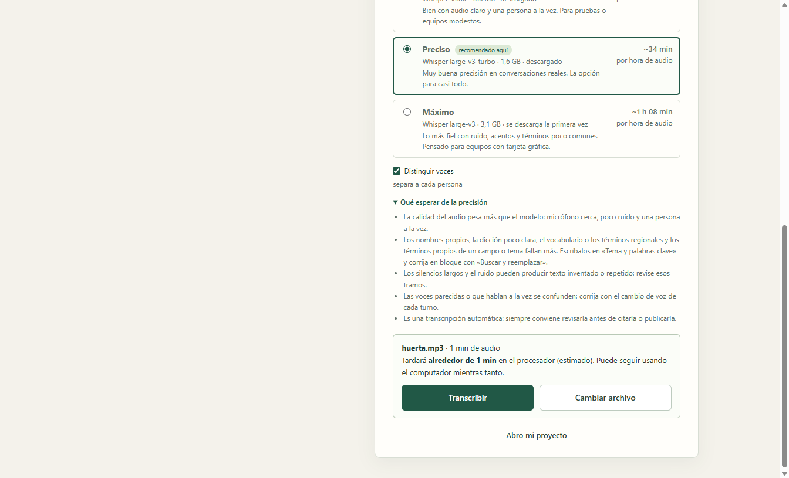
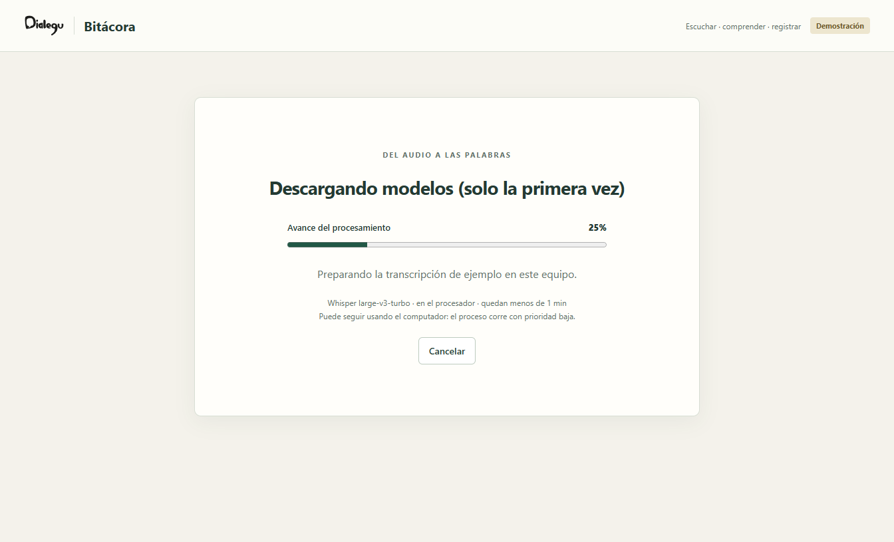
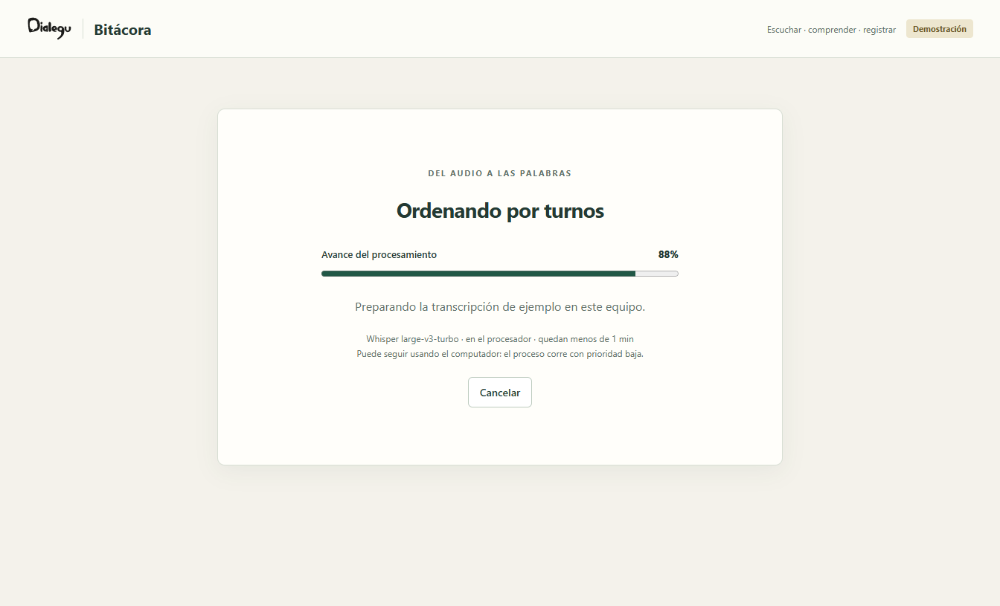
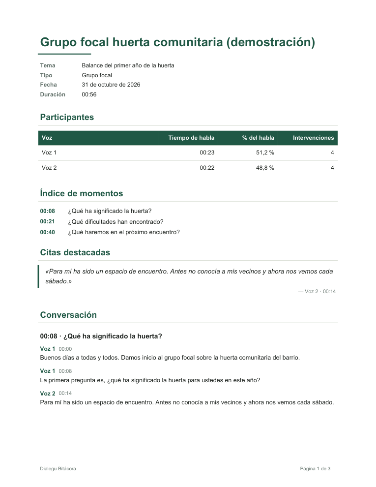
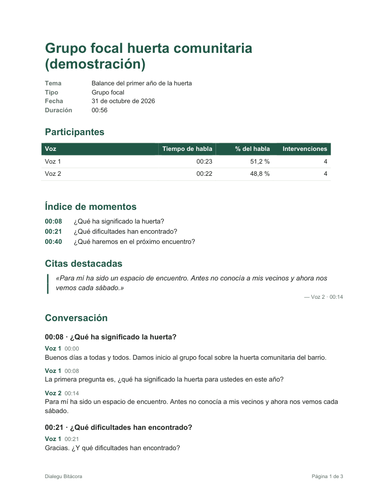
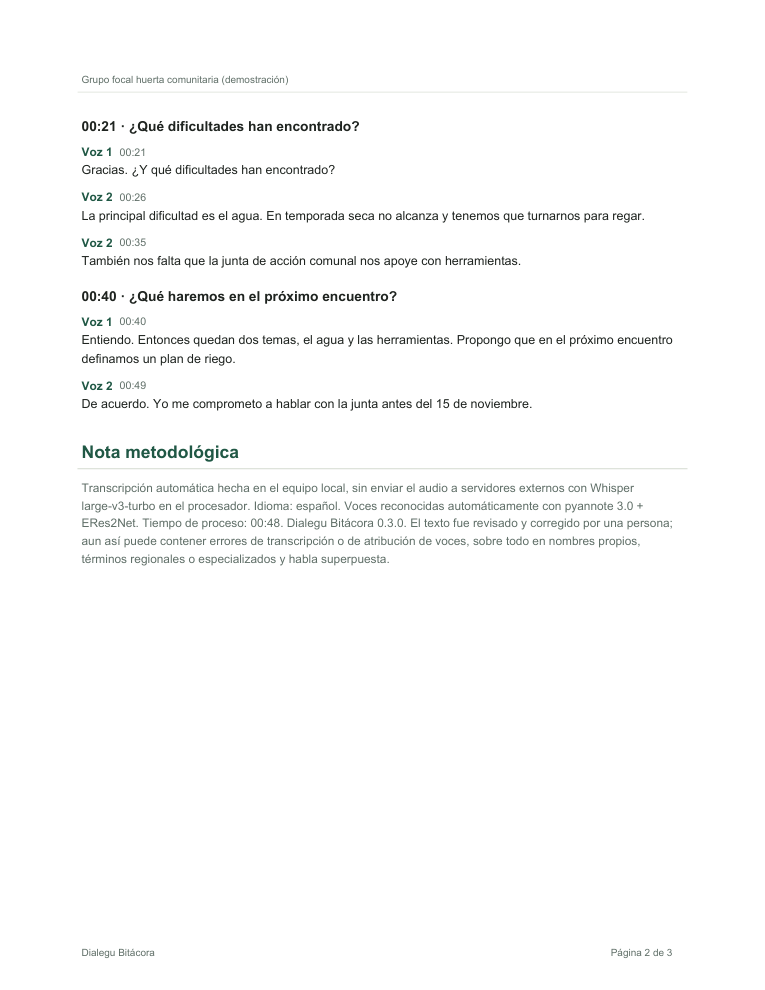
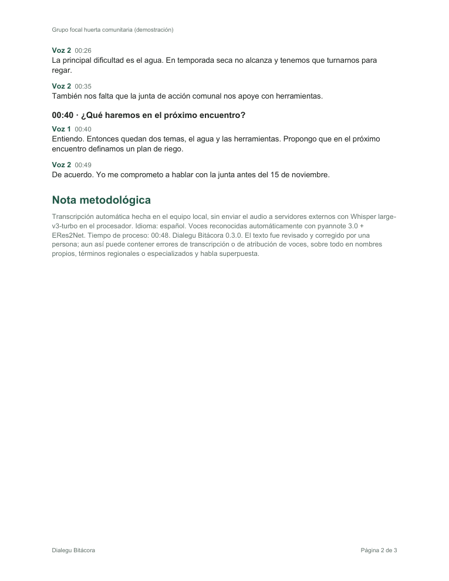

# Dialegu Bitácora

Aplicación de escritorio, libre y gratuita, para quienes facilitan procesos de construcción colectiva, investigan o sistematizan experiencias. Usted carga el audio o video de un **encuentro, un grupo focal o una entrevista**. La app lo devuelve **transcrito, separado por voces y ordenado por momentos**, listo para que una persona lo revise y exporte un informe en Word, PDF o Markdown.

**Todo ocurre en su equipo.** El audio y el texto no se envían a ningún servidor. Solo se necesita internet la primera vez, para descargar los modelos.

> **Una transcripción automática es un borrador.** Bitácora está pensada para que una persona revise el texto contra el audio antes de citarlo, analizarlo o publicarlo. Gran parte de la herramienta existe para que esa revisión sea rápida y cuidadosa: vea [Revisión humana](#revisión-humana-el-centro-de-la-herramienta).



## Contenido

- [Qué hace](#qué-hace)
- [Recorrido por la app](#recorrido-por-la-app)
- [Revisión humana: el centro de la herramienta](#revisión-humana-el-centro-de-la-herramienta)
- [Informes que exporta](#informes-que-exporta)
- [Instalar](#instalar-windows)
- [Privacidad y ética](#privacidad-y-ética)
- [Limitaciones conocidas](#limitaciones-conocidas)
- [Cómo funciona por dentro](#cómo-funciona-por-dentro)
- [Contribuir](#contribuir)
- [Desarrollo](#desarrollo)
- [Créditos y licencia](#créditos-y-licencia)

## Qué hace

- **Transcribe** audio o video de cualquier origen (celular, grabadora, Zoom, Meet, Teams): MP3, WAV, M4A, OGG, MP4, entre otros. La app no graba: se concentra en transcribir y organizar.
- **Distingue las voces** de cada participante y arma los turnos de conversación. Es opcional.
- **Le dice qué esperar en su propio equipo.** Detecta el procesador, la memoria y la tarjeta gráfica, recomienda un modelo y estima cuánto tardará. Usa una tarjeta NVIDIA si la hay.
- **Facilita la revisión humana:** audio sincronizado con el texto, atajos de teclado, buscar y reemplazar, cambio de voz por turno, unir y dividir turnos, citas y momentos.
- **Organiza un informe** según el tipo de sesión. En una entrevista, por preguntas y respuestas; en un grupo focal, por las preguntas de la guía; en un encuentro, por momentos.
- **Exporta** el informe a Word, PDF y Markdown, y la transcripción a PDF, Markdown, texto y subtítulos (SRT).
- **Guarda el proyecto** (`.bitacora`) para seguir revisando otro día.

## Recorrido por la app

### 1. Preparar la sesión

Escriba el nombre de la sesión, el tipo (encuentro, grupo focal o entrevista) y el idioma. El campo **«Tema y palabras clave»** importa mucho: los nombres propios, lugares y términos que escriba ahí se pasan al modelo para que los reconozca mejor.

La app muestra **su equipo** y los tres modelos disponibles. Para cada uno indica cuánto ocupa, si ya está descargado y cuánto tarda por hora de audio en ese computador. La estimación se ajusta con lo que tardaron sus transcripciones anteriores.



| Modelo | Whisper | Tamaño | Para qué |
|---|---|---|---|
| **Ligero** | small | 486 MB | Audio claro, una persona a la vez, equipos modestos o pruebas. |
| **Preciso** | large-v3-turbo | 1,6 GB | Conversaciones reales. La opción para casi todo. |
| **Máximo** | large-v3 | 3,1 GB | Ruido, acentos marcados y términos poco comunes. Pensado para equipos con tarjeta gráfica. |

### 2. Ajustar las expectativas

Antes de transcribir, el desplegable **«Qué esperar de la precisión»** explica qué suele fallar y cómo corregirlo. Conviene leerlo una vez: así se sabe dónde mirar durante la revisión.



### 3. Elegir el archivo y transcribir

Al elegir el audio, la app calcula cuánto tardará con el modelo y las opciones elegidas. También avisa si antes debe descargar algo o preparar la tarjeta gráfica. Mientras transcribe, el proceso corre con prioridad baja y puede seguir usando el computador.





Tiempos de referencia medidos en un i7-8700 con una GTX 1660 Ti, para una hora de audio con voces distinguidas:

- **Con tarjeta NVIDIA:** unos 17 minutos, con cualquiera de los tres modelos.
- **Solo con el procesador, modelo Preciso:** unos 30 a 35 minutos.

### 4. Revisar

La pantalla de revisión es donde se gana la calidad del registro. Se describe en detalle en la sección siguiente.

### 5. Exportar



## Revisión humana: el centro de la herramienta

Bitácora no promete una transcripción perfecta. Promete un **buen borrador y las herramientas para convertirlo, con poco esfuerzo, en un registro confiable**. Esto pesa sobre todo en investigación cualitativa, sistematización de experiencias, procesos comunitarios y cualquier caso en que las palabras de una persona se vayan a citar.

### Cuándo la revisión es imprescindible

Revise el texto completo, escuchando el audio, cuando:

- vaya a **citar textualmente** a alguien (tesis, artículos, informes, publicaciones);
- la sesión tenga **nombres propios, lugares, siglas o jerga** de una comunidad, una región o un campo de conocimiento;
- haya **ruido, eco, micrófono lejano** o personas que hablan a la vez;
- participen personas con **acentos marcados, dicción poco clara**, niñas, niños o personas mayores;
- el audio tenga **silencios largos** o pausas (ahí Whisper a veces inventa o repite texto);
- la **atribución de quién dijo qué** importe para el análisis (grupos focales, entrevistas con más de una persona).

### Errores típicos y cómo encontrarlos

| Qué pasa | Cómo se ve | Cómo se corrige en Bitácora |
|---|---|---|
| Palabra mal reconocida | Un término que no tiene sentido en contexto | Alt+clic sobre la palabra para escuchar ese punto y corregir en el mismo campo |
| Nombre propio o término escrito de varias formas | «Rosalba», «Rosa Alba», «Rosalva» | **Buscar y reemplazar** (Ctrl+F) en todo el documento |
| Texto inventado o repetido | Una frase que se repite o que nadie dijo, a menudo después de un silencio | Escuchar el tramo y borrar el texto sobrante |
| Voz equivocada | Un turno atribuido a otra persona | Cambiar la voz desde el selector del turno |
| Dos personas en un mismo turno | Pregunta y respuesta juntas | Poner el cursor donde cambia y **dividir** (Ctrl+Enter) |
| Un turno partido en dos | La misma persona, cortada | **Unir con el anterior** |
| Voces de más | «Voz 3» que en realidad es la Voz 1 | Reasignar sus turnos o nombrarla igual |

### Un flujo de revisión recomendado

1. **Nombre las voces** en el panel lateral: los nombres reales solo si las personas lo autorizaron; si no, seudónimos. El panel muestra cuánto habló cada voz, útil para detectar voces de más.
2. **Corrija primero en bloque** los nombres propios y términos repetidos con Buscar y reemplazar.
3. **Escuche y lea a la vez**, de principio a fin. Con «Seguir el audio» el turno activo acompaña la reproducción. Con «Pausar al escribir», el audio se detiene al escribir y retrocede 2 segundos al reanudar, para no perder el hilo.
4. **Revise con más atención** los tramos después de silencios largos y los cambios rápidos de voz.
5. **Marque los momentos** (preguntas de la guía, cambios de tema): organizan el informe y su índice.
6. **Marque las citas** mientras revisa: la estrella cita el turno completo y Ctrl+Q cita solo el texto seleccionado. Aparecen en el panel lateral y en «Citas destacadas» del informe.
7. **Guarde** el proyecto (Ctrl+S) para seguir otro día. Deshacer (Ctrl+Z) recupera el último cambio.

### Atajos de teclado

| Atajo | Acción |
|---|---|
| Ctrl+Espacio | Reproducir o pausar |
| Alt+← / Alt+→ | Retroceder o avanzar 5 segundos |
| Alt+clic en una palabra | Escuchar desde esa palabra |
| Ctrl+Enter | Dividir el turno donde está el cursor |
| Ctrl+Q | Citar el turno, o solo el texto seleccionado |
| Ctrl+F | Buscar y reemplazar |
| Ctrl+S | Guardar el proyecto |
| Ctrl+Z | Deshacer (fuera de los campos de texto) |

La barra de audio queda fija abajo, con retroceso y avance, velocidad de reproducción y posición. No hace falta volver arriba para pausar.

### La nota metodológica

Cada informe incluye una **nota metodológica** que declara cómo se produjo el registro: el modelo de Whisper, si corrió en la tarjeta gráfica o en el procesador, el idioma, el modelo de voces, el tiempo de proceso y la versión de la app. También declara que el texto fue revisado por una persona y que puede tener errores. Así el informe se puede citar con transparencia sobre su origen.

## Informes que exporta

El informe se organiza según el tipo de sesión e incluye:

- **Ficha:** tema, tipo, fecha y duración.
- **Participantes:** tiempo de habla, porcentaje e intervenciones de cada voz.
- **Índice de momentos.**
- **Citas destacadas,** con la voz y la hora.
- **Conversación** organizada: por preguntas en un grupo focal, por pregunta y respuesta en una entrevista o por momentos en un encuentro.
- **Nota metodológica.**
- **Anexo** con la transcripción completa, en página aparte.

En Word y PDF el informe va en hoja carta, con encabezado, numeración «Página X de Y», tablas legibles y citas destacadas. El PDF trae marcadores para navegar por secciones. El Word usa estilos de título reales (aparecen en el panel de navegación) y queda configurado en español para la revisión ortográfica.

| PDF | Word |
|---|---|
|  |  |
|  |  |

Otros formatos: transcripción en PDF, Markdown, texto plano y subtítulos SRT (para acompañar el video).

## Instalar (Windows)

1. Descargue el instalador desde [Releases](https://github.com/Vialgusi/dialegu-bitacora/releases).
2. Ejecútelo. Windows puede mostrar un aviso porque la app no tiene firma comercial: elija «Más información» y luego «Ejecutar de todas formas».
3. La primera vez que procese un audio, la app descarga los modelos: unos 550 MB con el modelo Ligero y más con los otros. La pantalla de inicio indica cuánto. Después funciona sin conexión.

**Con tarjeta gráfica NVIDIA** la transcripción es varias veces más rápida. La app la detecta sola. La primera vez descarga unos 570 MB de librerías de NVIDIA (cuBLAS) y prepara la tarjeta durante unos minutos. Si algo falla, sigue en el procesador.

Requisitos orientativos: Windows 10 u 11 de 64 bits, 8 GB de memoria (16 GB recomendados para los modelos Preciso y Máximo sin tarjeta gráfica) y espacio libre para los modelos.

## Privacidad y ética

- **Procesamiento local.** Ni el audio ni el texto salen del equipo. Las únicas conexiones son las descargas de modelos y librerías públicas, con versiones fijadas y verificadas por SHA-256.
- **Consentimiento informado.** Grabar la voz de una persona es recolectar un dato personal sensible. Pida y registre el consentimiento antes de grabar. Hay una guía práctica con modelos de texto en [docs/CONSENTIMIENTO-INFORMADO.md](docs/CONSENTIMIENTO-INFORMADO.md).
- **Seudónimos.** Nombre a las voces solo si las personas lo autorizaron; si no, use seudónimos antes de exportar.
- **Cuidado de los archivos.** El proyecto `.bitacora` y las exportaciones contienen la conversación completa. Guárdelos y compártalos con el mismo cuidado que el audio.

## Limitaciones conocidas

- Cuando dos personas hablan a la vez, el turno queda asignado a una sola.
- Voces muy parecidas, o una persona que cambia mucho su distancia al micrófono, pueden quedar mezcladas o divididas en varias voces.
- Tras silencios largos o con mucho ruido, Whisper puede inventar o repetir frases. Revise esos tramos.
- Los nombres propios y los términos poco comunes fallan más, aunque ayuda escribirlos en «Tema y palabras clave».
- La aceleración por tarjeta gráfica solo funciona con NVIDIA.
- Por ahora solo hay instalador para Windows.

## Cómo funciona por dentro

```
Electron + React (interfaz)  ──HTTP local con token──▶  Motor en Python (FastAPI)
                                                         ├─ faster-whisper / CTranslate2: transcripción (CPU o CUDA)
                                                         ├─ sherpa-onnx: segmentación pyannote 3.0 + huellas de voz 3D-Speaker
                                                         ├─ alineación de palabras con voces y armado de turnos
                                                         └─ exportadores: python-docx (Word), fpdf2 (PDF), Markdown, SRT
```

- `frontend/`: la interfaz (React 19 + Vite) y el proceso principal de Electron. Se puede ver sin motor en modo demostración.
- `backend/motor/`: transcripción, voces, alineación, cola de trabajos, detección del equipo y estimaciones, informe y exportación.
- `backend/servidor.py`: la API local que usa la interfaz. El contrato está en [docs/CONTRATO-MOTOR.md](docs/CONTRATO-MOTOR.md).
- `docs/specs/`: especificaciones de cada versión.

## Contribuir

Las mejoras son bienvenidas: errores, ideas, traducciones, pruebas en otros equipos y código. Lea [CONTRIBUTING.md](CONTRIBUTING.md). Algunas líneas abiertas:

- comparar modelos y parámetros de transcripción y de voces en español con audios reales;
- un instalador para macOS y Linux;
- más ayudas para la revisión, como marcar tramos dudosos o mostrar la confianza por palabra;
- informes con plantillas propias.

**Nunca suba audios ni transcripciones reales** a un issue o PR. Use audios propios sin datos personales o el modo demostración.

## Desarrollo

Requisitos: Python 3.11 y Node.js 20 o superior.

```bash
py -3.11 -m venv venv
venv\Scripts\python -m pip install -r backend/requirements-dev.txt
venv\Scripts\python -m pytest tests
cd frontend
npm ci
npm test
npm run electron:dev
```

- La interfaz se puede ver sin motor en `http://localhost:5175/?demo=1` (con `npm run dev`).
- Antes de abrir un PR: `python -m pytest tests` y, en `frontend`, `npm test && npm run lint && npm run build`.

Para generar el instalador:

```bash
cd frontend
npm run motor:build
npm run electron:build
```

### Publicar una versión

1. Cree y suba una etiqueta con la versión: `git tag v0.3.0` y `git push origin v0.3.0`. También se puede lanzar a mano desde *Actions → Release*.
2. El flujo [.github/workflows/release.yml](.github/workflows/release.yml) compila el motor y el instalador en Windows, calcula el SHA-256 y crea un **release en borrador** con el instalador y `SHA256SUMS.txt`.
3. Revise el borrador en [Releases](https://github.com/Vialgusi/dialegu-bitacora/releases) y publíquelo a mano.

## Créditos y licencia

- Transcripción: [faster-whisper](https://github.com/SYSTRAN/faster-whisper) (MIT), con los modelos Whisper de OpenAI (MIT).
- Reconocimiento de voces: [sherpa-onnx](https://github.com/k2-fsa/sherpa-onnx) (Apache-2.0), con la segmentación de [pyannote](https://github.com/pyannote/pyannote-audio) 3.0 (MIT) y las huellas de voz de [3D-Speaker](https://github.com/modelscope/3D-Speaker) (Apache-2.0).
- Exportación: [python-docx](https://github.com/python-openxml/python-docx) (MIT) y [fpdf2](https://github.com/py-pdf/fpdf2) (LGPL-3.0).

[GPL-3.0-or-later](LICENSE). Puede usarla, estudiarla, modificarla y redistribuirla; si distribuye una versión modificada, debe compartir también su código bajo la misma licencia.

Hecha por [Dialegu](https://dialegu.com).
